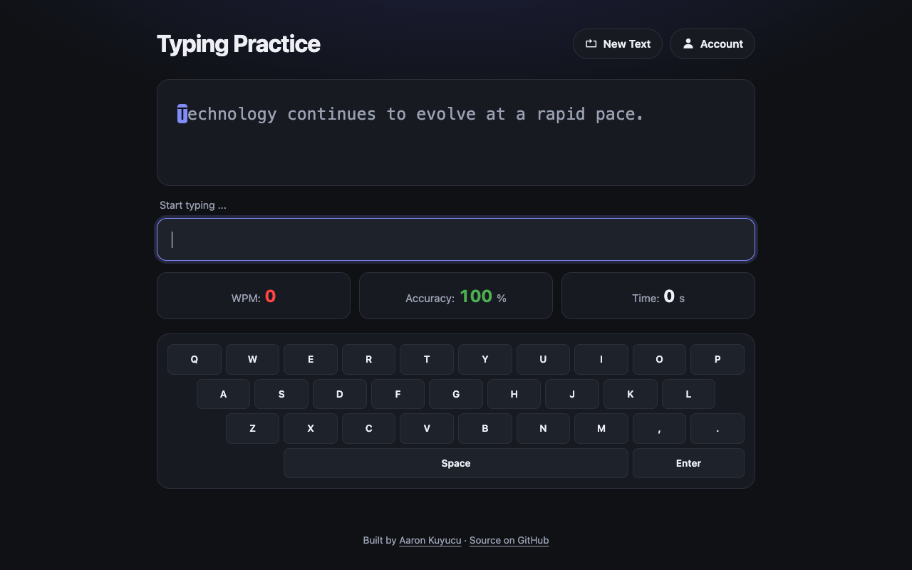

# Typing Trainer

Typing practice in the browser, inspired by Monkeytype: type a sample text and see speed, accuracy and time.



## Features

- Live feedback per character: green for correct, red for wrong
- On-screen keyboard that highlights the pressed key
- Words per minute, accuracy and time, with a summary at the end
- New text on demand
- Local sign-up and log-in pages with lifetime stats

## Tech

- HTML, CSS, vanilla JavaScript
- Keyboard events (`keydown`)
- `localStorage` for the demo account and stats

## How to run

Open the live version: **[aaronkuy.github.io/typing-trainer](https://aaronkuy.github.io/typing-trainer/)**

Or run it locally. There is no build step and no dependency:

```bash
git clone https://github.com/aaronkuy/typing-trainer.git
cd typing-trainer
open index.html        # macOS; on Linux use xdg-open, on Windows start
```

## What I learned

- Handling keyboard events and comparing input to a target text character by character
- Calculating WPM and accuracy while the user types
- Designing separate log-in and sign-up pages

## What I'd do next

- Replace the demo account: it stores the password in plain text in `localStorage`, which is fine for an exercise but never for real users. Real accounts need a server and hashed passwords
- More texts and a choice of length
- A history chart of past runs

## Notes

The account feature is a front-end exercise only. Do not use a real password.

## License

See [LICENSE](LICENSE).
