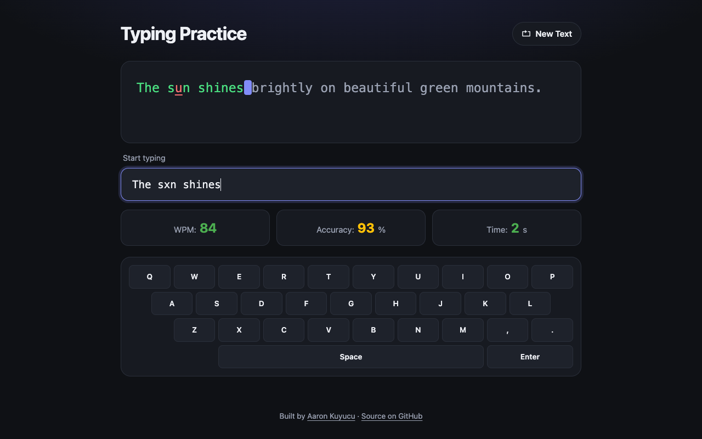

# Typing Trainer

Typing practice in the browser, inspired by Monkeytype: type a sample text and see speed, accuracy and time.



## Features

- Live feedback per character: green for correct, red for wrong
- On-screen keyboard that highlights the pressed key
- Words per minute, accuracy and time, with a summary at the end
- New text on demand, also with `Esc`

## Tech

- HTML, CSS, vanilla JavaScript
- Keyboard and `input` events

## How to run

Open the live version: **[aaronkuy.github.io/typing-trainer](https://aaronkuy.github.io/typing-trainer/)**

Or run it locally. There is no build step and nothing to install:

```bash
git clone https://github.com/aaronkuy/typing-trainer.git
cd typing-trainer
open index.html        # macOS; on Linux use xdg-open, on Windows start
```

The page loads one external stylesheet, [Boxicons](https://boxicons.com/) from unpkg, for the icon on the "New Text" button.

## Tests

The WPM and accuracy calculations live in `stats.js` as pure functions and are covered by tests that use Node's built-in test runner (Node 20 or newer, no packages):

```bash
node --test
```

## How accuracy is counted

Accuracy is the share of correct keystrokes among all keystrokes. Backspace does not take a keystroke back, so a mistake that was corrected still counts. WPM is gross: it counts every character in the input field, wrong ones included, with five characters as one word. Characters removed with Backspace no longer count.

## What I learned

- Handling keyboard events and comparing input to a target text character by character
- Calculating WPM and accuracy while the user types

## What I'd do next

- More texts and a choice of length
- Keep past results (for example in `localStorage`) and show them as a chart

## License

See [LICENSE](LICENSE).
